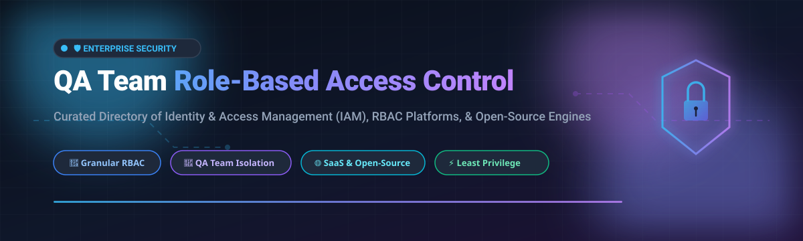

# 🛡️ Awesome QA Team Role-Based Access Control (RBAC) 🔐

> A curated list of top **Role-Based Access Control (RBAC)** platforms, **Identity and Access Management (IAM)** systems, and open-source authorization engines tailored for QA teams, testing environments, permissions isolation, and least-privilege security.

  
  
  
  
  
  

🌟 **Star this repository if you find it helpful for architecting QA environments and access security!** 🌟

---

## 📑 Table of Contents

- [🌐 Sector Overview & Market Dynamics](#-sector-overview--market-dynamics)
- [🟦 SaaS / Hosted Platforms](#-saas--hosted-platforms)
  - [SaaS Products Detailed Breakdown](#-saas-products-detailed-breakdown)
- [🟩 Open-Source Software](#-open-source-software)
- [📊 Comparison Matrix at a Glance](#-comparison-matrix-at-a-glance)
- [📈 Star History](#-star-history)
- [💖 Support](#-support)
- [🤝 Contributing](#-contributing)
- [📄 License](#-license)

---

## 🌐 Sector Overview & Market Dynamics

The global **Identity and Access Management (IAM)** market is estimated at **$22.9B – $26.8B in 2025** (scaling toward $60B+ by the mid-2030s), while the dedicated **Role-Based Access Control (RBAC)** sub-segment accounts for approximately **$11.6B – $12.5B**. The sector is **moderately fragmented** rather than winner-take-all: while enterprise titans (Microsoft, CyberArk, Okta) command dominant market share in enterprise-wide single sign-on and governance, an active ecosystem of specialized testing clouds (e.g., BrowserStack) and modern authorization standards (Casbin, OPA, OpenFGA) thrive by addressing granular workload-level and developer-centric authorization needs.

---

## 🟦 SaaS / Hosted Platforms

Below is the structured overview of commercial and hosted SaaS identity, test cloud, and RBAC solutions sorted in descending order by enterprise company size (market valuation / revenue).

| Product 🏷️ | Company Size (Valuation / Revenue) 🏢 | Starting Price 💵 | Free Tier / Free Trial Limits ⏳ | Key Capabilities for QA Teams 🎯 |
|:---|:---|:---|:---|:---|
| **[Microsoft Entra ID](https://www.microsoft.com/en-us/security/business/identity-access/microsoft-entra-id)** | **$3.1T+** Market Cap (Microsoft) | **$7.00 / user / month** (P1 tier, billed annually) | **Permanent Free Tier** (Included with Azure/M365 accounts; basic cloud SSO, tenant MFA defaults, and user directory; CIAM offers 50,000 MAUs free/mo) | Scoped access over app registrations, test tenant administration units, and PIM (Privileged Identity Management) just-in-time test access. |
| **[CyberArk Identity](https://www.cyberark.com/products/identity-management/)** | **$21.1B** Acquisition Valuation (~$1.36B ARR) | **~$2.00 – $5.00 / user / month** (Core SSO/MFA entry tier) | **14-day free trial** (Evaluation sandbox / lab tenant with core workforce SSO, MFA, and sample policy assignments) | Dynamic JavaScript-based attribute rules to automatically assign QA engineers to staging environments based on team metadata. |
| **[Okta](https://www.okta.com/)** | **~$15.3B** Market Cap (~$2.6B ARR) | **$6.00 / user / month** (Workforce Starter; $1,500/year minimum contract) | **30-day free trial** (Full platform evaluation capped at 10 active testing users with SSO, MFA, and Universal Directory) | Scoped custom admin roles with granular permission bundling (`okta.apps.manage`) to isolate test automation from production apps. |
| **[BrowserStack](https://www.browserstack.com/)** | **~$4.0B** Valuation (~$225M ARR) | **$29.00 / user / month** (Live manual testing, billed annually) | **Free Trial** (30 minutes of Live interactive cross-browser testing + 100 minutes of Automate grid execution) | Native **Project API** with project-scoped roles (Admin, User, Viewer), team-level role inheritance, and test environment isolation. |
| **[JumpCloud](https://jumpcloud.com/)** | **~$2.6B** Valuation (~$200M ARR) | **$9.00 / user / month** (Device Management tier, billed annually) | **30-day free trial** (Full-featured access to cloud directory, device management, and SSO; legacy accounts retain 10 users / 10 devices free) | Cloud directory supporting up to 20 custom admin roles to grant QA testers device control without exposing identity administration. |
| **[Auth0](https://auth0.com/)** | **$6.5B** (Acquired by Okta; ~$400M+ ARR unit) | **$35.00 / month** (B2C Essentials, 500 MAUs) / **$150.00 / month** (B2B Essentials) | **Permanent Free Tier** (Up to **25,000 Monthly Active Users (MAUs)**, unlimited social logins, 5 organizations, and custom domains) | API-level RBAC tokens enforcing scopes on automated testing scripts, mock endpoints, and QA microservice test suites. |
| **[OneLogin](https://www.onelogin.com/)** | **~$500M** Valuation (One Identity; ~$70M ARR) | **$3.00 / user / month** (Basic tier, billed annually) | **30-day free trial** (Full-featured trial covering SSO, MFA, app catalog connectors, and directory attribute mapping) | App-centric role bundling with attribute-based automated provisioning (e.g., automatically assign test suites to `Department = QA`). |

---

### 🔍 SaaS Products Detailed Breakdown

#### 1. 🌐 [Microsoft Entra ID](https://www.microsoft.com/en-us/security/business/identity-access/microsoft-entra-id)
- **Primary Type:** Enterprise Cloud Identity & Access Platform 🏢
- **RBAC Model:** Scoped directory roles, Administrative Units (AUs), and Azure RBAC assignments.
- **QA Team Utility:** QA teams often require elevated rights in development sandboxes without compromising organizational security. Entra ID provides built-in and custom roles scoped strictly to specific app registrations, groups, or administrative units. Combined with **Privileged Identity Management (PIM)**, testers can request time-bound, just-in-time access for executing compliance tests.

#### 2. 🔐 [CyberArk Identity](https://www.cyberark.com/products/identity-management/)
- **Primary Type:** Identity Security & Dynamic Workforce Access 🛡️
- **RBAC Model:** Role-based policy assignment with dynamic membership scripts.
- **QA Team Utility:** QA team members frequently rotate across projects. CyberArk Identity enables dynamic roles powered by JavaScript logic that evaluate user attributes (such as department, team tag, or test run assignment) to automatically grant access to specific testing portals and revoke it when tests conclude.

#### 3. 🎯 [Okta Workforce Identity Cloud](https://www.okta.com/)
- **Primary Type:** Enterprise Workforce IAM & Cloud Federation ☁️
- **RBAC Model:** Standard and granular custom administrative roles with resource sets.
- **QA Team Utility:** Provides custom admin roles that decouple administrative privileges. Testers can be granted permissions like `okta.apps.manage` or `okta.users.appAssignment.manage` restricted strictly to pre-production applications, preventing accidental cross-tenant disruption.

#### 4. 🧪 [BrowserStack Role-Based Access Control](https://www.browserstack.com/)
- **Primary Type:** QA & Test Execution Cloud with Project Governance 🚀
- **RBAC Model:** Hierarchical project-scoped RBAC with team inheritance.
- **QA Team Utility:** Purpose-built for testing teams. Through BrowserStack's **Project API**, QA leaders can assign granular roles (Admin, User, Viewer) per project. Teams inherit access permissions while maintaining isolated execution environments, preventing external contractors or individual QA squads from accessing confidential builds.

#### 5. 💻 [JumpCloud](https://jumpcloud.com/)
- **Primary Type:** Cloud Directory Platform & Unified Device Management 🖥️
- **RBAC Model:** Category-based custom admin permissions (up to 20 roles).
- **QA Team Utility:** Allows organizations to construct dedicated "QA Tester" admin roles that grant rights to manage test devices, deploy mobile configurations, and run diagnostic commands without providing visibility into corporate credentials or directory root objects.

#### 6. 🔑 [Auth0](https://auth0.com/)
- **Primary Type:** Developer-Centric Identity & Token-Based Authorization ⚡
- **RBAC Model:** API-level RBAC, custom claims, and scopes validation.
- **QA Team Utility:** Enables engineering teams to test role-restricted API endpoints. Testers and test automation pipelines can generate tokens containing specific scopes to rigorously validate that forbidden actions produce HTTP 403 Forbidden responses.

#### 7. 🔗 [OneLogin](https://www.onelogin.com/)
- **Primary Type:** Cloud IAM with Application-Centric Provisioning 📦
- **RBAC Model:** App-bundle roles with directory rule mappings.
- **QA Team Utility:** Groups all testing utilities (Bug tracker, CI/CD runners, staging portals, device farms) into a cohesive "QA Environment" role that is automatically populated via SAML/SCIM directory mappings when new test engineers join.

---

## 🟩 Open-Source Software

Self-hosted and community-driven access control solutions, authorization engines, and IAM suites. Sorted in descending order by GitHub stargazer count.

| Project & Repo 📦 | Stars ⭐ | Stack / Tech ⚙️ | License 📜 | Authorization Paradigm 💡 | Best For QA Teams 🎯 |
|:---|:---:|:---|:---:|:---|:---|
| **[Keycloak](https://github.com/keycloak/keycloak)** |  | Java, Quarkus | Apache-2.0 | Full IAM, Realm/Client RBAC, OIDC/SAML | Complete self-hosted IAM stack for staging environments with LDAP/AD federation and user simulation. |
| **[Authelia](https://github.com/authelia/authelia)** |  | Go, TypeScript | Apache-2.0 | Forward-Auth RBAC, 2FA/MFA, OIDC Provider | Protecting test environment reverse proxies (Nginx/Traefik) with single sign-on and 2FA gating. |
| **[Casbin](https://github.com/casbin/casbin)** |  | Go, Java, Python, Node, C++, Rust | Apache-2.0 | Multi-model RBAC, ABAC, ACL, RESTful | Embedding flexible model-driven access control directly into custom test tools and internal QA harnesses. |
| **[ZITADEL](https://github.com/zitadel/zitadel)** |  | Go, Next.js | Apache-2.0 | Multi-tenant RBAC, OIDC, Passkeys, Audit Trails | Cloud-native multi-tenant identity testing with instant self-service organization and role isolation. |
| **[Casdoor](https://github.com/casdoor/casdoor)** |  | Go, React | Apache-2.0 | UI-first Casbin RBAC, OAuth2/OIDC, SAML | Providing a full web management UI on top of Casbin for testers and QA administrators. |
| **[Ory Kratos](https://github.com/ory/kratos)** |  | Go | Apache-2.0 | Headless Identity, Account Management | Headless authentication testing where QA teams validate customized registration and login UX flows. |
| **[Open Policy Agent (OPA)](https://github.com/open-policy-agent/opa)** |  | Go, Rego | Apache-2.0 | Policy-as-Code (RBAC, ABAC, Kubernetes admission) | Automated policy regression testing and enforcing test cluster admission rules across microservices. |
| **[OpenFGA](https://github.com/openfga/openfga)** |  | Go | Apache-2.0 | Fine-Grained Authorization (Zanzibar-style ReBAC) | Modeling complex relationship-based access controls (e.g. project collaborators, QA test run ownership). |
| **[Permify](https://github.com/Permify/permify)** |  | Go | Apache-2.0 | Zanzibar ReBAC & Multi-tenant RBAC | Validating distributed authorization policies across complex microservice test topologies. |
| **[Ory Keto](https://github.com/ory/keto)** |  | Go | Apache-2.0 | Google Zanzibar ReBAC / RBAC Engine | Ultra-fast permission check validation within API performance and load testing pipelines. |
| **[Cerbos](https://github.com/cerbos/cerbos)** |  | Go | Apache-2.0 | Stateless Context-Aware RBAC/ABAC | Running stateless test sidecars with dedicated unit-testing tools for permission policies. |
| **[go-iam](https://github.com/melvinodsa/go-iam)** |  | Go, MongoDB, Redis, React | Apache-2.0 | Multi-tenant RBAC, OAuth2 Clients | Lightweight multi-tenant IAM mock server deployable via Docker Compose for rapid testing cycles. |
| **[OpenRbac](https://github.com/raubinsharya/OpenRBAC)** |  | Python, SQLite/MySQL | Open Source | Data-scope RBAC, Unified CLI/Web verification | Lightweight standalone access verification tool for small QA labs without complex infrastructure. |
| **[maintainerd/auth](https://github.com/maintainerd/maintainerd-auth)** |  | Go, PostgreSQL, Redis | Apache-2.0 | OIDC, WebAuthn MFA, Granular RBAC | Modern containerized identity stack with audit logging and secret management for test clusters. |

---

## 📊 Comparison Matrix at a Glance

| System / Tool ⚙️ | Model Type 🏷️ | Deployment 🚀 | Project/Resource Scoping 🎯 | Dynamic / Attribute Roles ⚡ | Built-in Admin UI 🖥️ | Native QA Isolation 🧪 |
|:---|:---|:---|:---:|:---:|:---:|:---:|
| **Microsoft Entra ID** | Enterprise IAM | Cloud Hosted | ✅ Resource Targets | ✅ Group Rules | ✅ Yes | ✅ High |
| **CyberArk Identity** | Enterprise IAM / PAM | Cloud Hosted | ✅ Scoped Roles | ✅ JavaScript Rules | ✅ Yes | ✅ High |
| **Okta** | Enterprise IAM | Cloud Hosted | ✅ Resource Sets | ✅ Dynamic Groups | ✅ Yes | ✅ High |
| **BrowserStack** | QA Platform RBAC | Cloud Hosted | ✅ Project API | 🔄 Team Inheritance | ✅ Yes | ✅ Purpose-Built |
| **JumpCloud** | Directory & MDM | Cloud Hosted | ✅ Scoped Categories | ❌ Manual/Group | ✅ Yes | ✅ Medium |
| **Auth0** | Developer IAM | Cloud Hosted / Private | ✅ API Scopes | ✅ Actions/Rules | ✅ Yes | ✅ High |
| **OneLogin** | Enterprise IAM | Cloud Hosted | ✅ App Catalog | ✅ Directory Mappings | ✅ Yes | ✅ Medium |
| **Keycloak** | Full Open-Source IAM | Self-Hosted | ✅ Realm / Client | ✅ Composite Roles | ✅ Yes | ✅ High |
| **Authelia** | Forward-Auth SSO | Self-Hosted | ✅ URL / Network Rules | ✅ Rule Criteria | ✅ Yes | ✅ High |
| **Casbin** | AuthZ Engine Library | Embedded / Self-Hosted| ✅ Model-Defined | ✅ Script Matchers | ❌ Library | ✅ Custom |
| **ZITADEL** | Multi-Tenant IAM | Cloud / Self-Hosted | ✅ Org / Project Roles | ✅ Metadata Mappings | ✅ Yes | ✅ High |
| **Casdoor** | Casbin Web Platform | Self-Hosted | ✅ Casbin Adapter | ✅ Casbin Engine | ✅ Yes | ✅ High |
| **Open Policy Agent**| Policy Engine (Rego) | Embedded / Sidecar | ✅ Context-Dependent | ✅ Expressive Rego | ❌ Engine | ✅ High |
| **OpenFGA / Permify**| Zanzibar ReBAC | Microservice / Docker | ✅ Relation Graphs | ✅ ReBAC / ABAC | ✅ Yes | ✅ High |
| **Cerbos** | Stateless PDP | Sidecar / Container | ✅ Resource Policies | ✅ Condition Logic | ✅ Cerbos Hub | ✅ High |
| **go-iam** | Multi-Tenant Server | Self-Hosted / Docker | ✅ Tenant Scoping | 🔄 Role Assignment | ✅ Yes | ✅ Medium |
| **OpenRbac** | Terminal / Web Tool | Self-Hosted / CLI | ✅ Data Scope | ❌ Static Roles | ✅ Web + CLI | ✅ Low |

---

## 📈 Star History

---

## 💖 Support

If you find this repository valuable for organizing and securing your QA environments, testing pipelines, and access architecture, consider showing your support:

- 🌟 **Star this repository** to help others discover it on GitHub!
- 🍴 **Fork the repo** to contribute new tools or maintain your customized bookmarks.
- 📢 **Share with colleagues** in the software testing, security, and DevOps communities.
- ☕ **Sponsor or buy a coffee** to fuel continuous updates: [**Sponsor ishandutta2007 on GitHub Sponsors**](https://github.com/sponsors/ishandutta2007)

---

## 🤝 Contributing

Contributions are warmly welcome! If you know of an open-source authorization library, QA-specific permission management system, or cloud IAM tool that should be listed here:

1. Fork this repository.
2. Add your tool to the relevant section (maintain ascending/descending sorting rules where applicable).
3. Ensure links, licenses, and technical details are verified and accurate.
4. Submit a Pull Request with a short summary of the addition.

Please refer to the comprehensive [Awesome Directory](https://github.com/ishandutta2007/Awesome-Awesome-Awesome) for more curated software lists.

---

## 📄 License

This compilation is licensed under the [Creative Commons Zero v1.0 Universal (CC0-1.0)](https://creativecommons.org/publicdomain/zero/1.0/). Listed software tools, brand names, and trademarks belong to their respective copyright holders.
